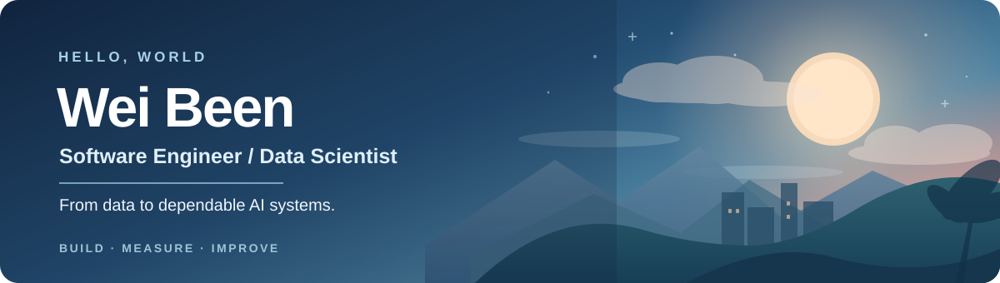

  

### About me

I build and operate software where **AI meets real-world products**. My background spans **three years in data science** and hands-on full-stack engineering, with a focus on turning model-powered ideas into reliable production systems.

I work on software supporting **AI-assisted echocardiography**, connecting clinical workflows with dependable applications and services. I care about the whole journey: from understanding data and validating assumptions to shipping, measuring, and maintaining the system.

### From data to production

| 01 · Understand | 02 · Build | 03 · Operate |
| :--- | :--- | :--- |
| Data analysis, modeling, validation | APIs, web applications, integrations | Cloud, observability, performance, reliability |
| **Is it useful and correct?** | **Can people use it?** | **Will it keep working?** |

### What I work with

**Applications** · Python · FastAPI · Django · TypeScript · Angular  
**Data & infrastructure** · MongoDB · Redis · AWS · Docker · Terraform  
**Observability** · OpenTelemetry · SigNoz

### My engineering approach

> Measure before optimizing. Make changes reviewable. Think about failure modes. Prefer evidence over intuition.

- **Full-stack engineering:** designing maintainable interfaces, APIs, and workflows.
- **Production reliability:** safer migrations, authentication, tracing, and performance profiling.
- **AI systems:** improving the deployment and operation of model-powered products.

<strong>Currently exploring</strong>

- Efficient ML inference and serving
- Performance benchmarking and optimization
- Reliable, observable AI applications

